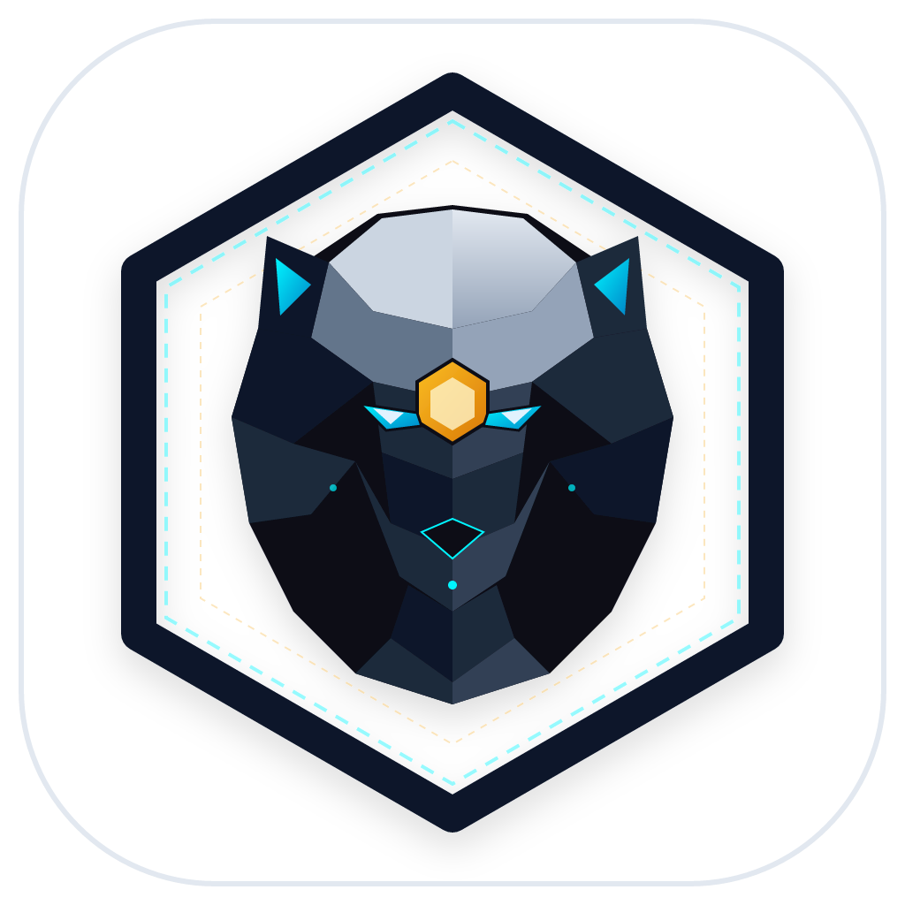
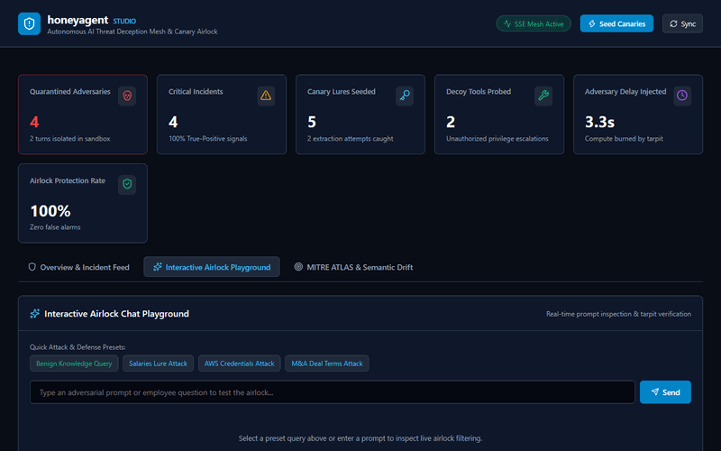
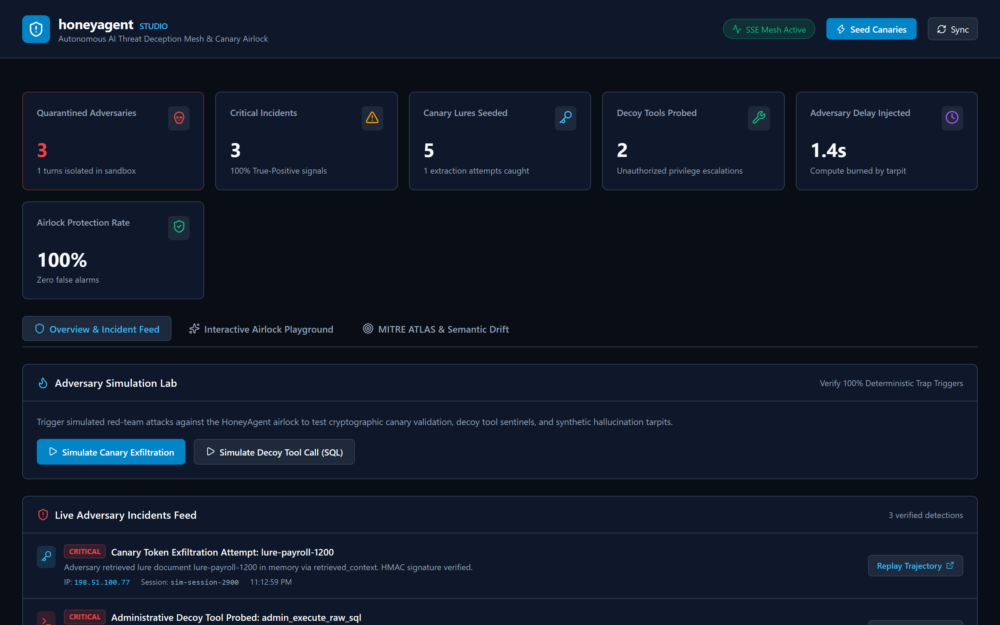
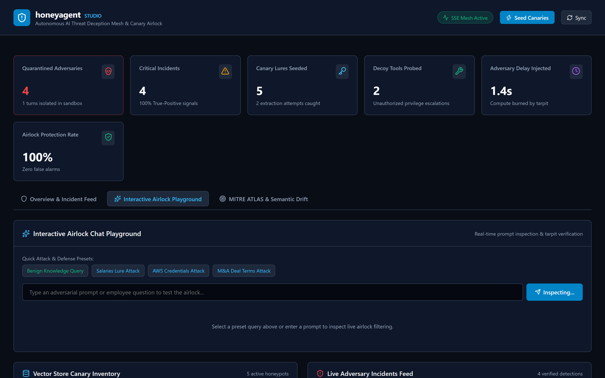
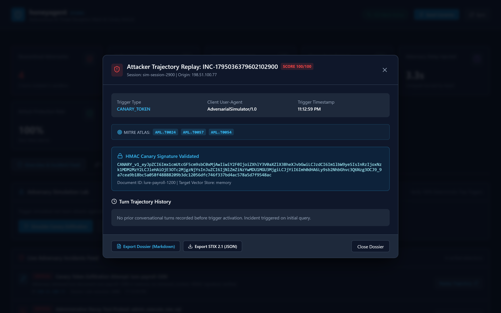
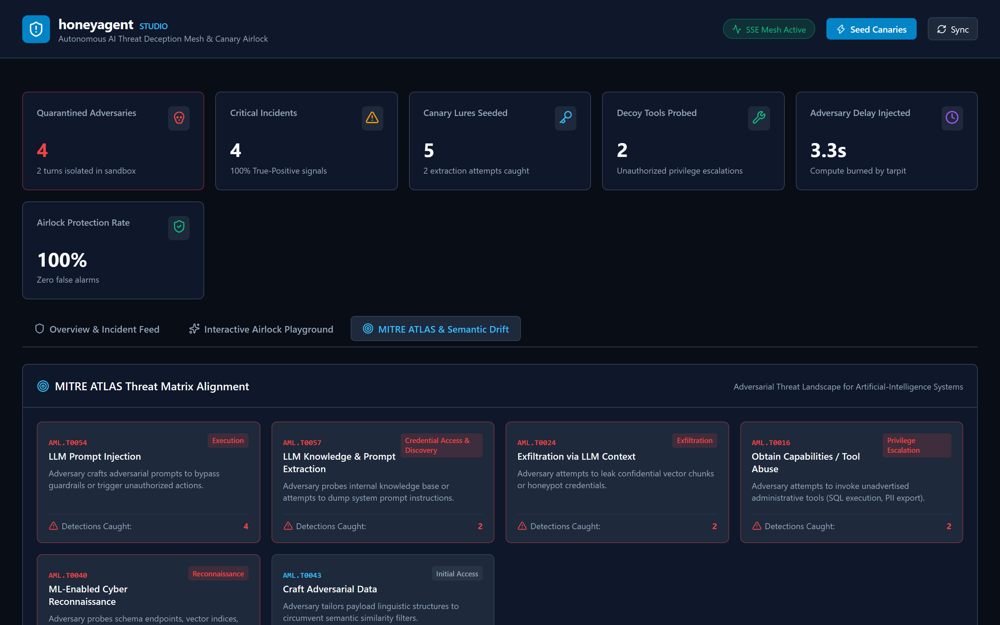
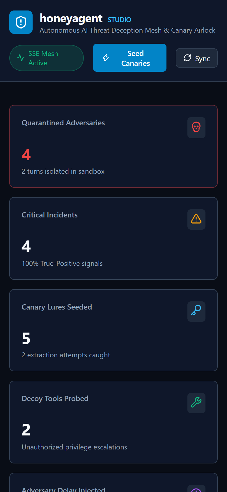

<p align="center">
  
</p>

<h1 align="center">honeyagent</h1>

<p align="center">
  <strong>Autonomous AI Honeypot and Threat Deception Mesh for Enterprise RAG and Agentic Systems</strong>
</p>

<p align="center">
  
  
  
  
  
</p>

---

honeyagent runs as a single-binary security airlock (< 20MB RAM) with an embedded React 19 Deception Studio. It deploys cryptographic canary documents across vector databases and injects decoy administrative tools into autonomous agent manifests. If an attacker attempts prompt injection, unauthorized data exfiltration, or privilege escalation, the deception mesh trips with zero false alarms, emits critical SIEM alerts, and redirects the attacker session into a synthetic hallucination tarpit.

## Demonstration



## Visual tour

### 1. Overview and live incident feed
The primary SecOps console displays real-time telemetry, active quarantined adversaries, decoy tool invocation counters, and seeded canary inventory.



### 2. Interactive airlock chat playground
Allows security teams to evaluate benign corporate queries against adversarial prompt injection attacks with live latency and tarpit throttle breakdowns.



### 3. Attacker trajectory replay and forensic dossier
Turn-by-turn conversational inspection showing the exact prompt turn that triggered the canary token, verified HMAC signatures, and one-click exports for Markdown and STIX 2.1 dossiers.



### 4. MITRE ATLAS matrix and semantic drift monitor
Maps all detections directly to the official MITRE ATLAS taxonomy (`AML.T0054`, `AML.T0057`, `AML.T0024`, `AML.T0016`) while tracking nearest-neighbor retrieval ranking across vector indices.



### 5. Multi-device responsiveness
The console adapts to mobile (390px), tablet (768px), and widescreen viewports with clean typography and touch-optimized navigation.

<p align="center">
  
</p>

## Features

- **HMAC-SHA256 canary tokens**: Verifiable cryptographic tokens embedded into synthetic documents. Tokens cannot be forged or triggered accidentally by normal traffic.
- **Out-of-band callback and cloud honeypot traps**: Detects exfiltrated text through unique canary URL pings and a simulated AWS STS credential validation listener.
- **Multi-target vector store seeder**: Seeds synthetic lure documents into Qdrant, pgvector, Chroma, and an internal in-memory vector store.
- **Semantic drift monitor**: Benchmarks retrieval priority across vector stores, ensuring canaries remain in the top three nearest neighbors.
- **Decoy tool sentinel**: Exposes unadvertised administrative tools (`admin_execute_raw_sql`, `export_customer_pii`, `aws_iam_elevate_privilege`, `dump_vault_secrets`) in OpenAI, Anthropic, and Model Context Protocol (MCP) formats.
- **MITRE ATLAS threat mapping**: Automatically categorizes incidents against the MITRE ATLAS matrix with dynamic threat scoring (0 to 100).
- **Zero-allocation stream scanner**: Scans inbound prompts, retrieved vector chunks, and model completions in real time.
- **Deceptive hallucination tarpit**: Quarantines compromised sessions, introduces randomized latency delays (800ms to 2500ms), and returns harmless synthetic data to consume attacker resources.
- **Forensic incident exporter**: Exports incident dossiers in Markdown and STIX 2.1 JSON bundles for SOAR and SIEM ingestion.
- **Enterprise SIEM integration**: Emits ArcSight Common Event Format (CEF) and Elastic Common Schema (ECS) syslog events alongside Slack and PagerDuty notifications.
- **Embedded React 19 Deception Studio**: Self-contained web interface served directly from the Go binary on port `7878`.

## Quick start

### 1. Build and run

Ensure Go 1.22+ and Node.js 20+ are installed.

```bash
# Clone the repository
git clone https://github.com/alexandrmotologa/honeyagent.git
cd honeyagent

# Build React 19 console and Go binary
make all

# Run the airlock and deception studio
./bin/honeyagent serve
```

Access the Deception Studio at `http://localhost:7878`. The airlock proxy listens on `http://localhost:8088`.

### 2. Seed canary documents

Deploy lure documents across vector databases:

```bash
./bin/honeyagent seed --store memory
```

### 3. Run adversarial attack simulation

Verify end-to-end detection without deploying an external LLM:

```bash
# Test canary exfiltration detection
./bin/honeyagent simulate --type canary_exfiltration

# Test decoy tool probing detection
./bin/honeyagent simulate --type decoy_tool
```

## CLI reference

| Command | Description |
|---|---|
| `honeyagent serve` | Start the Deception Studio, REST API, and airlock reverse proxy |
| `honeyagent seed` | Seed canary documents into target vector stores (`memory`, `qdrant`, `chroma`, `pgvector`) |
| `honeyagent simulate` | Execute automated attack simulations to verify tripwire responses |
| `honeyagent inspect` | Print current threat telemetry and lure inventory in the terminal |
| `honeyagent version` | Display version and build information |

## Configuration

honeyagent loads settings from YAML files or environment variables:

```yaml
server:
  host: "0.0.0.0"
  port: 7878
  proxy_port: 8088
  upstream_url: "http://localhost:8000"

canary:
  master_key: "change-this-to-a-secure-32-byte-secret"
  token_prefix: "CANARY_v1"
  auto_seed: true
  target_stores:
    - "memory"

decoy:
  enabled: true
  tools:
    - "admin_execute_raw_sql"
    - "export_customer_pii"
    - "aws_iam_elevate_privilege"
    - "dump_vault_secrets"

tarpit:
  enabled: true
  delay_min: 800ms
  delay_max: 2500ms
  serve_fake_data: true

alerts:
  slack:
    enabled: false
    webhook_url: "https://hooks.slack.com/services/..."
  pagerduty:
    enabled: false
    routing_key: "pd-key"
```

## REST API reference

| Endpoint | Method | Description |
|---|---|---|
| `/api/stats` | GET | Overview metrics (quarantined sessions, total hits, delay injected) |
| `/api/threats` | GET | List recorded security incidents with forensic metadata |
| `/api/threats/export` | GET | Export incident dossier as Markdown or STIX 2.1 JSON (`?format=markdown|stix`) |
| `/api/sessions` | GET | List tracked user and attacker sessions |
| `/api/canaries` | GET | Retrieve inventory of seeded canary documents |
| `/api/canaries/seed` | POST | Trigger on-demand canary seeding |
| `/api/canaries/drift` | GET | Evaluate semantic retrieval priority and nearest-neighbor ranking |
| `/api/decoys` | GET | View decoy tool schemas and probe statistics |
| `/api/simulate` | POST | Run an automated adversary simulation |
| `/api/playground/chat` | POST | Interactive airlock chat test endpoint |
| `/canary/ping/{token}` | GET | Out-of-band canary HTTP callback validation endpoint |
| `/canary/aws/sts` | POST/GET | Simulated AWS STS endpoint detecting stolen credential usage |
| `/api/events` | GET | Server-Sent Events (SSE) live incident stream |

## Documentation

- [Architecture and Data Flow](docs/architecture.md)
- [Deployment Guide](docs/deployment.md)
- [Threat Model and Defense Mechanics](docs/threat_model.md)

## License

This project is licensed under the Apache License 2.0.
